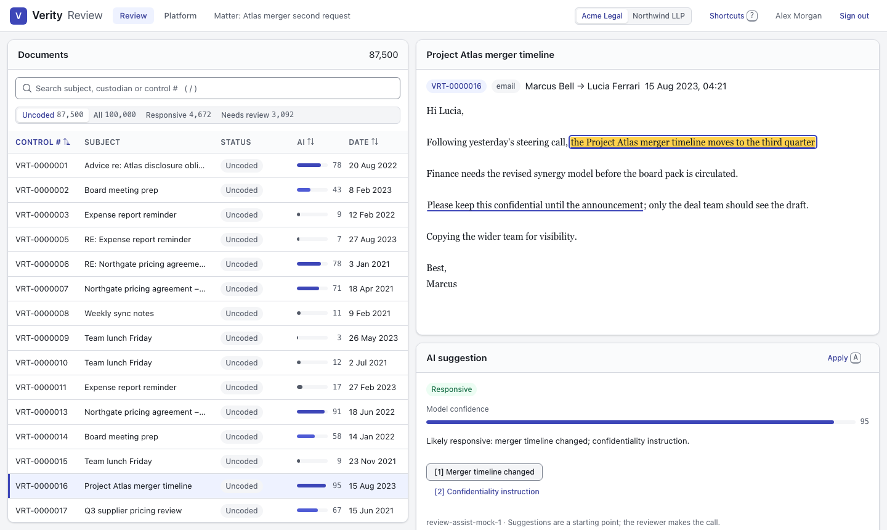
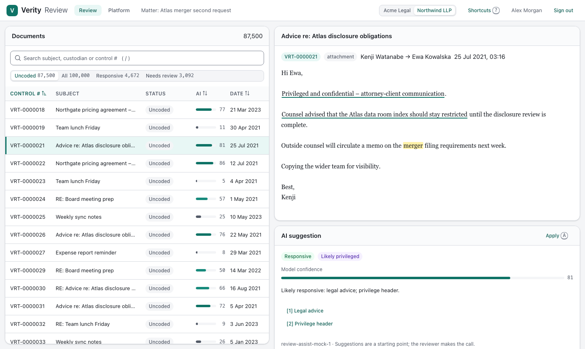
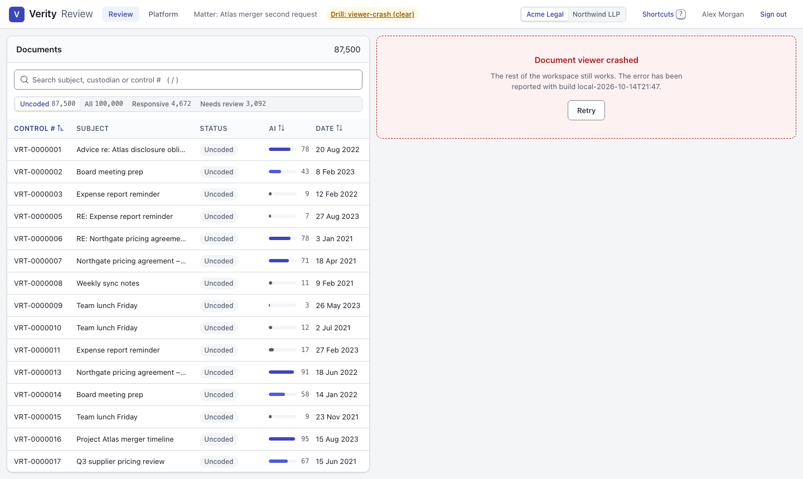
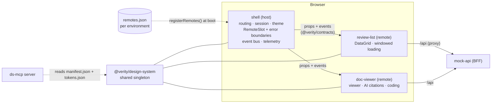
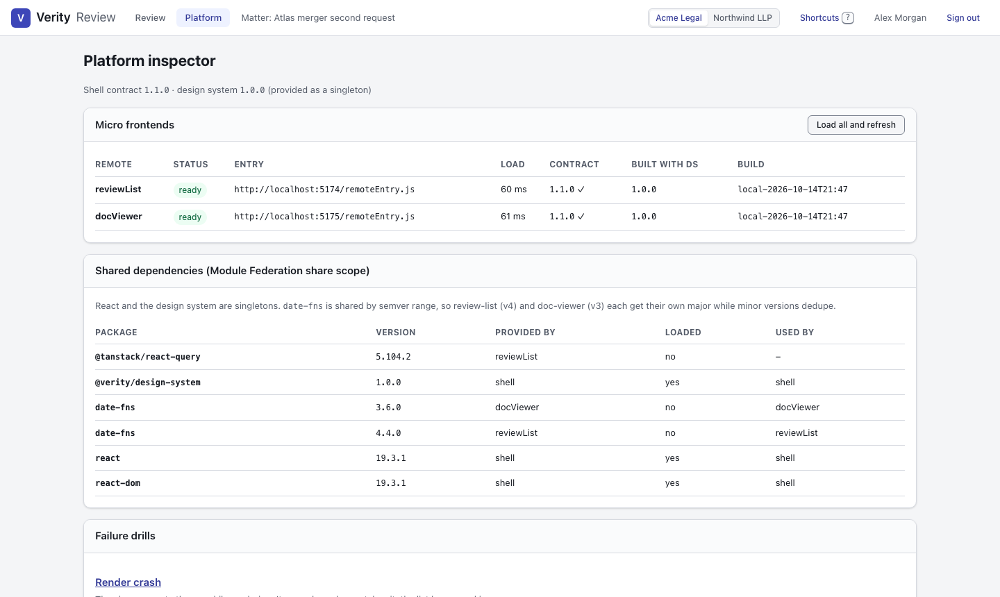

# Verity Review: micro frontends + design system reference platform

A working, tested reference platform for a legal document-review product:

- **Micro frontends with Module Federation 2.0 on Vite 8.** A host shell composes two independently deployable remotes at runtime.
- **A multi-tenant design system** that wraps PrimeReact (unstyled + pass-through) behind its own API, themed by design tokens.
- **Platform guardrails:** a typed host/remote contract, failure isolation, accessibility in unit and E2E tests, bundle budgets, changesets, and CI.
- **An MCP server** that gives coding agents (Claude Code, Cursor) the design system's components, props, tokens and rules.

**Live demo: https://verity-review.vercel.app** (no sign-up; pick a demo reviewer). The two remotes are deployed
separately at [verity-review-list.vercel.app](https://verity-review-list.vercel.app) and
[verity-doc-viewer.vercel.app](https://verity-doc-viewer.vercel.app).

> Portfolio project built to explore the problems a frontend platform team owns. "Verity", "Acme Legal" and
> "Northwind LLP" are fictional; all data is generated.



## Quick start

Requires Node 24+ and pnpm 12 (`corepack enable` picks up the pinned version).

```bash
pnpm install
```

```bash
pnpm dev
```

Open http://localhost:5173 and continue as a demo reviewer. `pnpm dev` builds the shared packages, then runs every app:

| App | Port | What it is |
| --- | --- | --- |
| `apps/shell` | 5173 | Host: routing, session, theming, remote orchestration, platform inspector |
| `apps/review-list` | 5174 | Remote: virtualized, keyboard-first list of 100,000 documents |
| `apps/doc-viewer` | 5175 | Remote: document viewer, AI suggestion with citations, coding form |
| `apps/mock-api` | 5180 | Node host for `@verity/review-api`, the deterministic review API (BFF stand-in) |

Each remote also runs standalone with a fake platform harness (http://localhost:5174, http://localhost:5175), so its team can work without the shell.

| Command | Does |
| --- | --- |
| `pnpm start` | Production build of every app, then `vite preview` (what E2E runs against) |
| `pnpm test` | Unit tests in every package (Vitest + Testing Library + axe) |
| `pnpm lint` / `pnpm typecheck` | ESLint (incl. jsx-a11y and governance rules) / TypeScript |
| `pnpm e2e` | Playwright against the composed production build, incl. axe WCAG 2.2 AA scans |
| `pnpm size` | Bundle budgets (size-limit) |
| `pnpm storybook` | Design-system docs on http://localhost:6006 with a tenant switcher |
| `pnpm changeset` | Record a version bump + release note for the design system or contracts |
| `pnpm mcp` | Run the design-system MCP server on stdio (already registered in `.mcp.json`) |
| `pnpm deploy:vercel [app…]` | Static deploy to Vercel, one project per app (see [Deployment](#deployment)) |

## A five-minute demo

1. **Theme by tenant.** Sign in as *Northwind LLP*, then switch tenants in the header. Colours, radii and row density change everywhere from one token cascade, with no rebuild.
2. **Review with the keyboard.** Tab into the list, use ↑ ↓ and Enter, press `1` (responsive) and `P` (privileged), then `Ctrl+Enter` to save and move on. The viewer emits `document.coded` and `review.advance`; the list updates the row and opens the next document. Press `?` for every shortcut.
3. **Check the AI evidence.** In the AI suggestion panel, each citation scrolls to and highlights the passage it relies on. Applying the suggestion is an explicit action (`A`), never automatic.
4. **Run the failure drills.** On *Platform → Failure drills*: a remote that crashes while rendering, a remote whose `remoteEntry.js` is unreachable, and a remote built against an incompatible contract. The shell and the other remote keep working each time.
5. **Inspect the platform.** *Platform* shows each remote's load time, contract, design-system version and build id, plus the live Module Federation share scope. React is a singleton; `date-fns` 3 and 4 run side by side.
6. **Ask an agent.** In Claude Code, enable the `verity-design-system` MCP server and ask it to build a screen. It reads components, props and tokens from the published manifest and reviews its own output with `review_snippet`.

| Northwind tenant (teal, rounder, roomier rows) | Failure isolation drill |
| --- | --- |
|  |  |

## Deployment

Each app is its own Vercel project, so each can be released and rolled back on its own:

| Project | URL | Serves |
| --- | --- | --- |
| `verity-review` | https://verity-review.vercel.app | Shell. SPA rewrite to `index.html`; `remotes.json` is `no-cache` |
| `verity-review-list` | https://verity-review-list.vercel.app | Remote. CORS open for `remoteEntry.js` and assets; `remoteEntry.js` is `no-cache`, hashed assets immutable |
| `verity-doc-viewer` | https://verity-doc-viewer.vercel.app | Remote. Same headers |

```bash
pnpm deploy:vercel
```

That command deploys the remotes first, then the shell. Passing app names ships only those apps:

```bash
pnpm deploy:vercel doc-viewer
```

That redeploys the viewer without touching the shell. `scripts/deploy-vercel.mjs` builds each app and copies its `vercel.json` (headers, rewrites) into `dist/`. It then deploys with the Vercel CLI and writes the shell's `remotes.json` from the remotes' production URLs. That's ADR 0001's "the registry is per environment" in practice.

**There is no backend.** Deploy builds set `VITE_API_MODE=browser`, so `@verity/review-api` (the same Fetch-API router `apps/mock-api` serves in Node) runs inside the visitor's tab behind a patched `fetch('/api/…')`. The remotes don't know the difference. Every visitor gets a private, in-memory sandbox that resets on reload. A patched `fetch` is used rather than a service worker so hard reloads keep working.

The E2E suite runs against the live site too:

```bash
E2E_BASE_URL=https://verity-review.vercel.app pnpm e2e
```

## Architecture



```
apps/
  shell/            host application
  review-list/      remote: document list
  doc-viewer/       remote: viewer + coding
  mock-api/         Node host for the review API (local dev + E2E)
packages/
  design-system/    components, tokens, Storybook, manifest
  contracts/        host<->remote contract, event bus, API types, compatibility check
  build-config/     platform-owned build preset: ports, proxy, Module Federation share policy
  ds-mcp/           MCP server over the design-system manifest
  review-api/       review API as a Fetch-API router + 100k seeded documents (Node or browser)
e2e/                Playwright + axe against the composed production build (or a live URL)
scripts/            deploy-vercel.mjs
docs/adr/           architecture decision records
```

## Decisions and trade-offs

The ADRs hold the full reasoning. This is the short version, the part to explain in an interview.

| # | Decision | Main trade-off |
| --- | --- | --- |
| [0001](docs/adr/0001-module-federation-on-vite.md) | Module Federation 2.0 on Vite, remotes registered **at runtime** from a per-environment `remotes.json` | Independent deploys and rollbacks without a shell rebuild; costs a runtime contract check and a registry to operate |
| [0002](docs/adr/0002-design-system-wraps-primereact.md) | The design system **wraps PrimeReact 10 in unstyled + pass-through mode** behind a narrower, owned API | We own all the CSS, but product code never sees PrimeReact, so the v10 → v11 rewrite (new API, new licence) becomes an internal migration |
| [0003](docs/adr/0003-contracts-and-versioning.md) | A versioned **contract package** (props, events, `RemoteModule` shape) plus a semver compatibility check; remotes never import each other (lint-enforced) | Every new capability is a contract bump; in return, breaking changes fail closed, before mounting |
| [0004](docs/adr/0004-failure-isolation.md) | **Every remote mounts in a `RemoteSlot`** that handles fetch failure, contract mismatch and render crashes, reporting to telemetry with the build id | Each failure mode needs its own fallback UX; it also gives incident triage a starting point |
| [0005](docs/adr/0005-design-tokens-multi-tenant.md) | **DTCG tokens → CSS custom properties** with semantic tokens re-resolved per `[data-tenant]` scope; contrast and token-usage checks run as tests | Runtime theming with no rebuild per tenant; the token build is a pipeline step everyone depends on |

More decisions, made in code:

- **Share policy is owned by the platform** (`packages/build-config`). React, ReactDOM and the design system are singletons, with `strictVersion` on React; everything else is shared by semver range. Remotes can't misconfigure it.
- **Each remote owns its TanStack Query cache.** No shared mutable state between remotes; cross-remote updates travel as events. The cost is some duplicated fetching, the benefit is isolation.
- **Remotes ship no global CSS.** They compose `Panel`, `Stack` and `SplitLayout`, which use **container queries**, so a remote adapts to the slot it's given, not the viewport.
- **Windowed loading + virtualization.** The list holds a sparse array of 100k rows, fetches 100-row pages as the visible range moves, and the grid keeps `aria-rowcount`/`aria-rowindex` correct for screen readers.
- **Docs can't drift.** Component metadata is typed against the real props interfaces (`PropDocs<P>`), so an undocumented or renamed prop fails typecheck. Storybook, `manifest.json` and the MCP server all read that metadata.
- **AI UX is explainable and opt-in.** A suggestion shows its confidence, rationale and citations into the document text; applying it is an explicit reviewer action.

## Quality gates

| Gate | Where |
| --- | --- |
| 125 unit tests: components, contracts, windowed loading, shortcuts, failure isolation, API, MCP tools | `pnpm test` |
| Token contrast for every tenant (WCAG 1.4.3 / 1.4.11) and "no raw colours" in component CSS | `packages/design-system/src/tokens.test.ts` |
| axe in unit tests (jsdom) and in Playwright against the real composed app (WCAG 2.2 AA tags) | `components.test.tsx`, `e2e/tests` |
| ESLint: jsx-a11y, React Compiler rules, no `primereact` imports in apps, no app-to-app imports | `eslint.config.js` |
| Bundle budgets: each remote adds about 9 KB brotli on top of the shared dependencies | `.size-limit.json` |
| Changesets required for design-system/contract changes in pull requests | `.github/workflows/ci.yml` |
| 10 E2E tests: keyboard review flow, theming, focus-trapped dialog, all three failure drills, share scope; run locally, in CI and against the live site | `pnpm e2e` |



## What production would add

This repo shows the architecture, so some parts are deliberately stubbed:

- **Continuous deployment:** run `pnpm deploy:vercel` from CI with a Vercel token, using Turborepo's change detection to deploy only the apps a commit touched. Use preview deploys per pull request, with a per-PR `remotes.json`.
- **Identity:** a real OIDC flow and token refresh in the shell. Remotes already receive the session through `PlatformContext`, so they wouldn't change.
- **Remote registry service:** `remotes.json` as a managed manifest per environment and tenant, enabling canaries ("5% of Acme on doc-viewer 1.8"), instant rollback and audit history.
- **Observability:** swap the in-memory telemetry for RUM/OpenTelemetry. Track Core Web Vitals (INP especially, for keyboard-heavy review), remote load timings and error rates per remote build.
- **Type-safe remotes:** Module Federation's DTS plugin, or publishing `@verity/contracts` as the only type surface (as done here).
- **Visual regression:** Storybook stories as Chromatic or Playwright screenshot tests per tenant.
- **Design-system lifecycle:** codemods for major versions, a deprecation policy, Figma variables syncing into the token JSON, and a dark theme as a third token set.
- **PrimeReact 11:** migrate inside the wrapper, component by component, behind the same public API (see ADR 0002).
